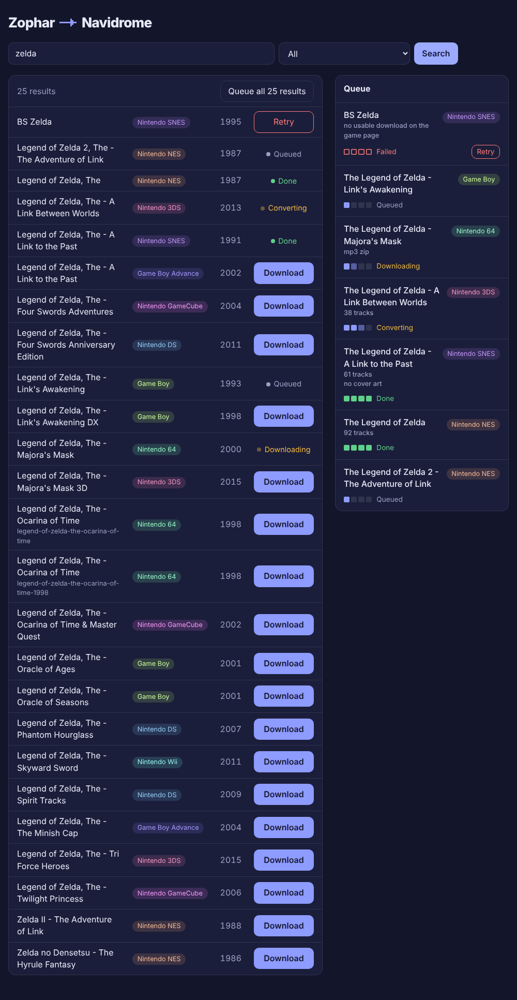
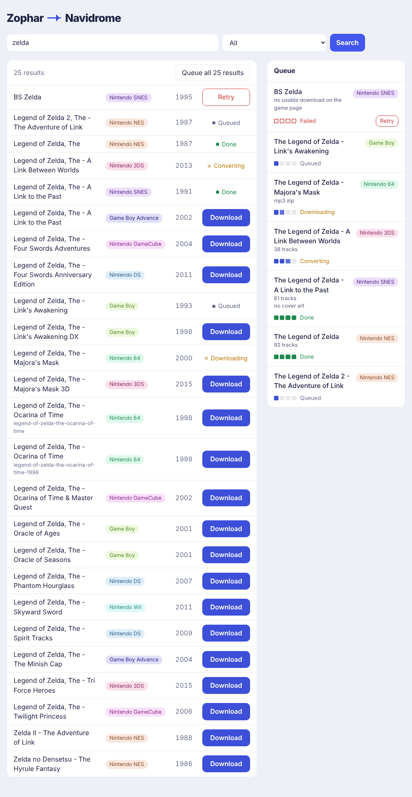

# zophar-fetch

A small self-hosted web app that searches [Zophar's Domain](https://www.zophar.net), queues downloads, and turns each
game soundtrack into a tagged album for [Navidrome](https://www.navidrome.org):
`/music/Zophar/<System>/<Game>/NNN - Title.flac`, then Navidrome is told to rescan. No manual tagging.



<details><summary>Light mode</summary>


</details>

## Please read first
- This is a personal-use tool for building a library of game music you can't get officially. Zophar's Domain hosts
  volunteer-made rips of copyrighted music. What you download, and whether you may, is your responsibility; replace
  rips with official releases where you can.
- It is polite to the site: one request at a time, a 2-second minimum gap between requests (`MIN_REQUEST_INTERVAL`),
  and only `zophar.net` hosts are ever contacted. Please leave the limit alone, and consider supporting Zophar's Domain.
- The web page has **no login**. Bind it to localhost or a private network (for example Tailscale), never the open internet.
- Not affiliated with Zophar's Domain or Navidrome.

## Status
- Page parsing is written against real saved Zophar pages (search results and a game page); the tests use saved copies
  of them. If Zophar changes its HTML, only `app/zophar.py` should need touching.
- Run end to end on a real home server: an NES game (original sound files, rendered with ffmpeg + libgme) and a 3DS game
  (Zophar's MP3s, retagged), with cover art and a Navidrome rescan.
- 37 automated tests. They need ffmpeg with libgme, so run them in the image (see below); CI does this on every push.

## Using it
- **Queue panel.** It shows what is running or waiting (whoever started it) plus the downloads started in this browser
  session. Closing the browser starts a fresh list. Nothing is deleted: every game's status is still remembered and shown
  next to it in the search results, and a note under the queue says how many earlier downloads are not listed.
- **Cancel.** A queued game has a Cancel button, and "Cancel all waiting" appears when several are queued. A download that
  has already started can't be cancelled. A cancelled game can be queued again.
- **Redo.** A finished game has a Redo menu: *Download again* repeats the job with the current settings, and *Again, keep
  all tracks* skips the length, silence and loop filters (use it if a real track was dropped). Both replace the existing
  album; the old one is only removed once the new one is complete. Navidrome greys out tracks whose files have gone, so
  after a redo that changes file names, clear them under **Missing Files**.

## What it downloads
Each Zophar game page offers two zips: the original sound files (EMU) and ready-made MP3s.
- Consoles libgme can render (NES, SNES, Game Boy, TurboGrafx, MSX, Master System/VGM): uses the original files,
  renders every subtrack to FLAC (or Opus) with real titles from the file or its .m3u. Tracks whose file or
  playlist states a length (NSFE, SPC tags, .m3u) are rendered at that length; the rest loop for `TRACK_SECONDS`
  with a fade-out.
- Everything else (3DS, DS, N64, GBA, GameCube, Wii, PSX/PS2, Saturn, Switch, ...): uses Zophar's MP3s as they
  are (no re-encoding), with clean tags added. Track names are whatever Zophar calls the files.
- Album name is the game name with the article put back first ("Legend of Zelda, The - X" becomes "The Legend of Zelda - X").
- MP3-route track names are tidied but not authoritative (`BossGetFanfare.ry.32.dspadpcm` becomes "Boss Get Fanfare"); Zophar only has the in-game filenames.
- Cover art is on by default: the game page's image is saved as cover.jpg/png in the album folder (`COVER=0` turns it off). If a game has none, or the fetch fails, the job still succeeds and the queue line says "no cover art". If an album folder already exists, the game is skipped without downloading. Albums are copied into a hidden
  `.incoming-<Game>` folder and renamed into place, so Navidrome never sees a half-written album.
- "Queue all N results" queues up to `MAX_BATCH` (default 100) games from a search, with a confirm prompt. Still one job at a time, at the 2-second request limit.
- Sound effects and one-shot jingles are left out, on the MP3 route too (tracks shorter than `MIN_TRACK_SECONDS`): each subtrack is probed first, and anything with less than
  `MIN_TRACK_SECONDS` (default 20) of audible sound is skipped. Tracks that play once and go quiet are trimmed to where the
  sound stops instead of padded with silence. Set `MIN_TRACK_SECONDS=0` to keep everything. If nothing survives, the job
  falls back to Zophar's MP3s.
- `PREFER=mp3` forces MP3s everywhere (smaller, faster, lossy).
- These zips are big (300-400 MB each is normal). Temp space needs roughly 3x the zip size in `WORK_DIR`
  (defaults to the fetcher's data folder). Limit: `MAX_DOWNLOAD_MB` (default 1500).

## Deploy
Assumes Debian with Docker Engine and the Compose plugin (`docker compose version` works). Portainer is optional:
every step below has a Portainer equivalent, noted where it differs.

**Before you start**
- Pick the user that should own the music files and note `id -u` and `id -g` for it (these are `PUID` / `PGID`).
- Create the music folder, e.g. `sudo mkdir -p /srv/music && sudo chown PUID:PGID /srv/music`. It is the one folder
  you must create yourself. Everything else is created for you.
- Free disk space: about 3x the largest zip (roughly 1.2 GB) in `APPDATA` while a job runs, plus the albums
  themselves (a FLAC album is a few hundred MB; `OUTPUT_FORMAT=opus` is about 10x smaller).
- Tailscale (optional but recommended, see below) installed and up: `tailscale ip -4` prints an address.

**1. Put the source on the server and build the image**
```
scp -r zophar-fetch/ you@server:/opt/stacks/music/src      # or rsync, or git clone
ssh you@server
cd /opt/stacks/music/src
docker build -t zophar-fetch:local .
```
The build fails on purpose if the image's ffmpeg has no libgme. If it succeeds, run the tests inside the image
(they need ffmpeg+libgme, which is why they run there and not on your laptop):
```
docker run --rm -v "$PWD/tests:/srv/tests:ro" --entrypoint sh zophar-fetch:local   -c "pip install -q pytest httpx && python -m pytest -p no:cacheprovider /srv/tests"
```
All 37 should pass. If any fail, stop and fix that before deploying.

**2. Configure**
- Docker Compose: `cp .env.example .env` and edit it. `MUSIC_DIR`, `APPDATA`, `PUID`, `PGID` are required.
- Portainer: Stacks > Add stack > paste `compose.yml`, and enter the same variables under Environment variables.
  (The image `zophar-fetch:local` is built on the server in step 1, so the stack must run on that same host.)

Leave `FETCH_BIND` / `NAVIDROME_BIND` at `127.0.0.1` for the first run, or set them to the server's Tailscale IP
(`tailscale ip -4`) to reach the pages from your other devices. The fetcher page has no login, so never bind it to
a public address. If Tailscale isn't up when Docker starts the containers they fail to bind and keep retrying until
it is. To reach a localhost-only setup from your own machine: `ssh -L 8085:127.0.0.1:8085 -L 4533:127.0.0.1:4533 you@server`.

**3. Start**
```
docker compose up -d          # add --env-file path/to/.env if it lives elsewhere
docker compose ps
```
Expect `init` to show as exited (0): it created `${APPDATA}/navidrome`, `${APPDATA}/fetch` and `${MUSIC_DIR}/Zophar`
and gave them to `PUID:PGID`, and that is normal. `navidrome` should be running and `zophar-fetch` should become
`healthy` within about a minute. If not, see Troubleshooting.

**4. Create the Navidrome admin**
Open `http://<server>:4533` and create the admin user. Navidrome asks for this on first visit, and the fetcher
cannot trigger rescans until its `ND_USER` / `ND_PASS` match that account.

**5. Give the fetcher the real credentials**
Set `ND_USER` / `ND_PASS` to the admin you just created (edit `.env` or the Portainer stack variables), then:
```
docker compose up -d
```
Only the fetcher is recreated. These are stored as plain environment variables, which is another reason to keep both
pages Tailscale-only.

**6. First download (the real test)**
Open `http://<server>:8085` (`FETCH_PORT`), search for a small NES or Game Boy game (these use the original sound files, so they
exercise the rendering path), and press Download. Watch the queue go queued, downloading, converting, done. Then check:
- Files exist: `ls -l /srv/music/Zophar/*/*/` shows `001 - ....flac` files and a `cover.jpg` (or the queue says "no cover art").
- The queue line has no "Navidrome scan failed" note, and the album appears in Navidrome with correct title, artist and cover.
- A track plays, and short jingle tracks aren't padded out to three minutes.
Then try one console that uses Zophar's MP3s (e.g. a 3DS game) to exercise that path. If anything fails,
`docker compose logs zophar-fetch` has the full traceback.

**Updating, backing up, removing**
- Update the fetcher: copy in the new source, `docker build -t zophar-fetch:local .`, `docker compose up -d`.
- Update Navidrome: `docker compose pull navidrome && docker compose up -d` (or pin `NAVIDROME_TAG`).
- Back up `${APPDATA}` (Navidrome's database and playlists, and the fetcher's job list). The music can be re-fetched.
- Remove: `docker compose down`. Your music and `APPDATA` folders are left alone.

## Tuning
- `OUTPUT_FORMAT=opus` makes albums about 10x smaller.
- `TRACK_SECONDS` / `FADE_SECONDS` set the loop policy (default 180s with a 6s fade).
- `MIN_TRACK_SECONDS` (default 20) skips shorter tracks such as sound effects; `0` keeps everything.
- `MAX_TRACK_SECONDS` (default 600) caps tracks whose file or playlist states a length.
- `NAVIDROME_TAG` pins the Navidrome image version (default `latest`).
- `MIN_REQUEST_INTERVAL` (default 2s) is the politeness limit on zophar.net. Please leave it alone.

## Troubleshooting
- **Fetcher or Navidrome restarts with "permission denied":** the `init` container didn't run or `PUID`/`PGID` are
  unset. Check `docker logs` for the `init` container and that both variables are set in the stack.
- **Job fails immediately with an HTTP error:** Zophar may be blocking or rate-limiting you, or changed its layout.
  Check the queue line and `docker logs`; page parsing lives in `app/zophar.py`.
- **"already in library" but the album is wrong:** delete that game's folder under `Zophar/<System>/` and retry.
- **Albums don't show up in Navidrome:** the queue line says "Navidrome scan failed: ..." if the rescan call
  failed. Check `ND_USER`/`ND_PASS` match the admin you created, or run Scan in Navidrome's UI.
- **Fetcher shows "unhealthy":** `docker inspect --format '{{json .State.Health}}' <container>`.

- **"NumPy was built with baseline optimizations ... but your machine doesn't support":** the VM's CPU type is too basic for
  newer numpy builds. The image pins numpy 1.26 for this reason; if you see it anyway, set `MAX_LOOP_SECONDS=0` or give the VM
  the `host` CPU type in Proxmox.

## Tests
In the built image: see "Deploy" step 1 (the CI workflow does the same). Elsewhere:
`pip install -r requirements.txt pytest httpx && pytest tests` (needs ffmpeg with libgme).
